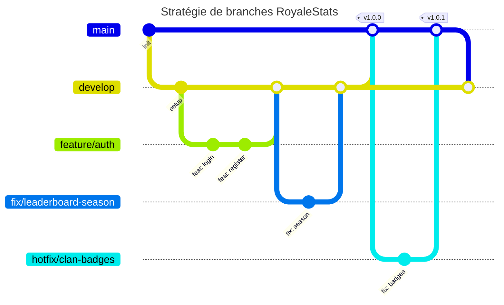

# Contribuer à RoyaleStats

Ce guide décrit la stratégie de branches, le nommage des commits et le parcours d'une contribution. Deux autres documents le complètent :

- [INSTALL.md](../docs/INSTALL.md) : installer et lancer le projet
- [GUIDELINE.md](../docs/GUIDELINE.md) : organisation du dépôt, style de code, tests

## Stratégie de branches



### Branches permanentes

| Branche   | Rôle                                                              | Qui y pousse             |
| --------- | ----------------------------------------------------------------- | ------------------------ |
| `main`    | Version stable, celle qu'on présente. Chaque fusion est taguée.   | Personne : PR uniquement |
| `develop` | Intégration du travail en cours. Doit toujours démarrer et builder. | Personne : PR uniquement |

### Branches de travail

Elles sont courtes : une branche par fonctionnalité ou correction, supprimée une fois fusionnée.

| Préfixe     | Usage                                        | Part de   | Fusionne dans        |
| ----------- | -------------------------------------------- | --------- | -------------------- |
| `feature/`  | Nouvelle fonctionnalité                      | `develop` | `develop`            |
| `fix/`      | Correction d'un bug présent sur `develop`    | `develop` | `develop`            |
| `chore/`    | Outillage, configuration, documentation      | `develop` | `develop`            |
| `hotfix/`   | Correction urgente d'un bug présent sur `main` | `main`    | `main` puis `develop` |

Le nom suit le format `<préfixe>/<sujet-court>`, en minuscules et avec des tirets : `feature/meta-tracker`, `fix/clan-badges`, `chore/setup-prisma`.

Il n'y a pas de branche par équipe ou par couche (`front`, `back`) : une branche partagée longtemps accumule les conflits et les commits de merge. Le travail front passe par des branches `feature/` comme le reste.

## Nommer les commits

Le nommage des commits doit se faire selon ce modèle :

```
<emoji> <type>(<portée>): <sujet>
[ligne vide]
[<description>]
[ligne vide]
[<footer>]
```

Exemples tirés de l'historique :

```
🛠 build(docker): optimize configuration and fix user-service build
📦 refactor(item-service): remove unused service
🐛 fix(ui): fix items & users list width
✨ feat(user-service): setup Prisma ORM with SQLite adapter
```

- **Type** : ce à quoi touche le commit, parmi cette liste :
  - 🛠 **build** : systèmes de build (Vite, Docker, pnpm, etc.)
  - ⚙️ **ci** : intégration continue
  - 📚 **docs** : documentation (`.md`, Swagger)
  - ✨ **feat** : nouvelle fonctionnalité
  - 🖼️ **views** : vues
  - 🛢️ **db** : migrations / seeds (structure ou contenu de la base de données)
  - 🐛 **fix** : correction de bug
  - 🚀 **perf** : amélioration des performances
  - 📦 **refactor** : modification du code qui ne change rien au fonctionnement
  - 💎 **style** : changement du style du code (formatage, quotes, etc.)
  - 🚨 **test** : tests
  - 🌀 **types** : typage, interfaces TypeScript
  - 🔖 **version** : mise à jour du numéro de version
  - ♻️ **other** : tout ce qui ne rentre pas dans les catégories précédentes

  Si vos modifications portent sur plusieurs de ces types, faites un commit séparé pour chacun.

- **Portée** (optionnelle) : la partie de l'application affectée. En pratique, le nom du paquet (`front`, `user-service`, `api-gateway`, …) ou un domaine transverse (`docker`, `ui`, `env`, `db`).
- **Sujet** : description claire de _tous_ les changements :
  - à l'impératif présent (_« ajoute »_, et non _« ajout »_),
  - en français ou en anglais,
  - sans majuscule au début,
  - sans point à la fin.
- **Description** : détaille les motivations derrière le changement. Mêmes règles que pour le sujet.
- **Footer** : signale les changements importants (_breaking changes_) et référence les issues / PR fermées par le commit, voir [fermer des issues avec un commit](https://help.github.com/en/github/managing-your-work-on-github/closing-issues-using-keywords).

L'emoji peut être saisi directement ou sous sa forme gitmoji (`:sparkles:`, `:bug:`, …), mais le `type` reste obligatoire : un emoji seul ne suffit pas.

## Parcours d'une contribution

1. Mettez `develop` à jour, puis créez votre branche :

   ```bash
   git checkout develop
   git pull
   git checkout -b feature/mon-sujet
   ```

2. Commitez en suivant les [conventions de commit](#nommer-les-commits).
3. Avant d'ouvrir la PR, récupérez les derniers changements de `develop` et résolvez les conflits de votre côté :

   ```bash
   git fetch origin
   git merge origin/develop
   ```

4. Poussez la branche et ouvrez une pull request vers `develop`.

## Pull requests

- Décrivez ce qui change, pourquoi, et comment le tester. Ajoutez une capture d'écran pour toute modification d'interface.
- Vérifiez que `pnpm format`, `pnpm lint` et `docker-compose up --build` passent sans erreur.
- Mettez à jour la documentation concernée : `README.md`, `.env.example`, spécification OpenAPI de la gateway.
- Faites relire la PR par un autre membre de l'équipe avant de la fusionner.
- Fusionnez avec un commit de merge, sans squash, puis supprimez la branche.

## Publier une version

1. Ouvrez une PR de `develop` vers `main` quand `develop` est stable.
2. Après fusion, taguez `main` :

   ```bash
   git checkout main
   git pull
   git tag v1.0.0
   git push origin v1.0.0
   ```

## Corriger en urgence

Un bug bloquant sur `main` se corrige sur une branche `hotfix/` créée depuis `main`. Une fois la PR fusionnée et `main` taguée, reportez la correction en fusionnant `main` dans `develop`.
