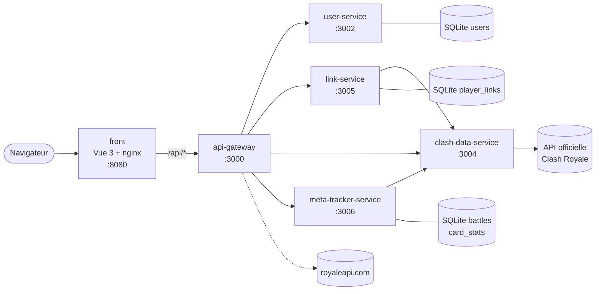

# RoyaleStats

[](https://github.com/NayanMallet/RoyaleStats/actions/workflows/ci.yml)

> Plateforme de statistiques Clash Royale : recherche de joueurs et de clans, classements, liaison d'un compte RoyaleStats à son profil de jeu et **Meta Tracker** pour suivre la méta.

Projet du M2 Expert Développement Web (Ynov). Monorepo pnpm : un front Vue 3 + TypeScript et des microservices Node.js/Express + SQLite, orchestrés avec Docker Compose.

## Démarrage rapide

Prérequis : Node 22 (`nvm use`), pnpm 10.20 (`corepack enable`), Docker et **votre propre clé API Clash Royale** (voir [INSTALL.md](docs/INSTALL.md#1-créer-sa-clé-api-clash-royale)).

```bash
pnpm install
cp .env.example .env          # puis renseigner CLASH_ROYALE_API_KEY
pnpm --filter shared build
docker compose up --build
```

| Application                      | Adresse                      |
| -------------------------------- | ---------------------------- |
| Front                            | <http://localhost:8080>      |
| API Gateway                      | <http://localhost:3000>      |
| Swagger (documentation de l'API) | <http://localhost:3000/docs> |

## Documentation

| Je veux…                                          | Document                                                                                            |
| ------------------------------------------------- | --------------------------------------------------------------------------------------------------- |
| Rejoindre le projet (parcours des premiers jours) | [docs/ONBOARDING.md](docs/ONBOARDING.md)                                                            |
| Installer, lancer et dépanner le projet           | [docs/INSTALL.md](docs/INSTALL.md)                                                                  |
| Comprendre l'architecture et les données          | [docs/ARCHITECTURE.md](docs/ARCHITECTURE.md)                                                        |
| Connaître les conventions de code                 | [docs/GUIDELINES.md](docs/GUIDELINES.md)                                                            |
| Contribuer (branches, commits, pull requests)     | [.github/CONTRIBUTING.md](.github/CONTRIBUTING.md)                                                  |
| Savoir pour qui on développe                      | [docs/PERSONAS.md](docs/PERSONAS.md)                                                                |
| Voir le découpage du backlog en releases          | [docs/STORYMAP.md](docs/STORYMAP.md)                                                                |
| Travailler sur le front                           | [front/README.md](front/README.md)                                                                  |
| Consulter l'API                                   | Swagger : <http://localhost:3000/docs> · spécification brute : <http://localhost:3000/openapi.json> |
| Suivre le backlog                                 | [Tableau Jira, projet `RST`](https://pablopjl64.atlassian.net/browse/RST)                           |

## Architecture en bref



Le détail (routes, données, flux, limites connues) est dans [docs/ARCHITECTURE.md](docs/ARCHITECTURE.md).

| Service                      | Port       | Rôle                                                                  |
| ---------------------------- | ---------- | --------------------------------------------------------------------- |
| `front`                      | 8080       | Interface Vue 3, servie par nginx qui relaie `/api/*` vers la Gateway |
| `api-gateway`                | 3000       | Point d'entrée unique, proxy vers les services, Swagger               |
| `user-service`               | 3002       | Comptes, connexion, JWT                                               |
| `link-service`               | 3005       | Liaison compte RoyaleStats ↔ tag Clash Royale                        |
| `clash-data-service`         | 3004       | Seul client de l'API Clash Royale, avec cache en mémoire              |
| `meta-tracker-service`       | 3006       | Collecte des combats et statistiques de la méta                       |
| `item-service`, `public-api` | 3003, 3001 | Services hérités du TP microservices, hors périmètre produit          |

## Stack technique

- **Front** : Vue 3, Vite, TypeScript, Pinia, Vue Router, Tailwind CSS 4, shadcn-vue (reka-ui), vee-validate + zod, vue-sonner
- **Back** : Node.js 22, Express 5, TypeScript, better-sqlite3, http-proxy-middleware, swagger-ui-express
- **Outillage** : pnpm workspaces, Docker Compose, ESLint, Prettier, Husky

## Équipe

| Membre           | GitHub                                         | Rôle              |
| ---------------- | ---------------------------------------------- | ----------------- |
| Nayan Mallet     | [@NayanMallet](https://github.com/NayanMallet) | Développeur back  |
| Dalyll Reguia    | [@ManaxBIP](https://github.com/ManaxBIP)       | Développeur front |
| Pablo Jean Louis | [@NotGrafik](https://github.com/NotGrafik)     | Développeur front |
