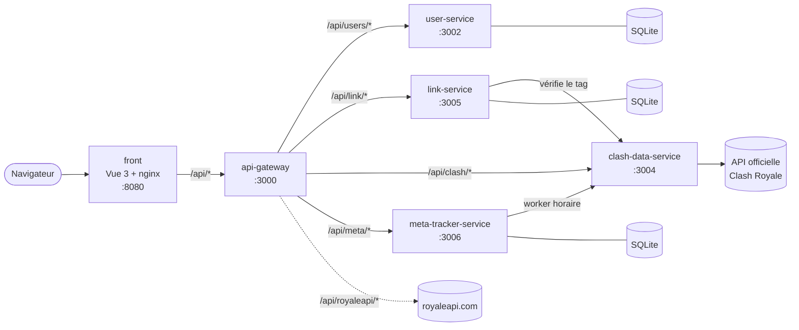
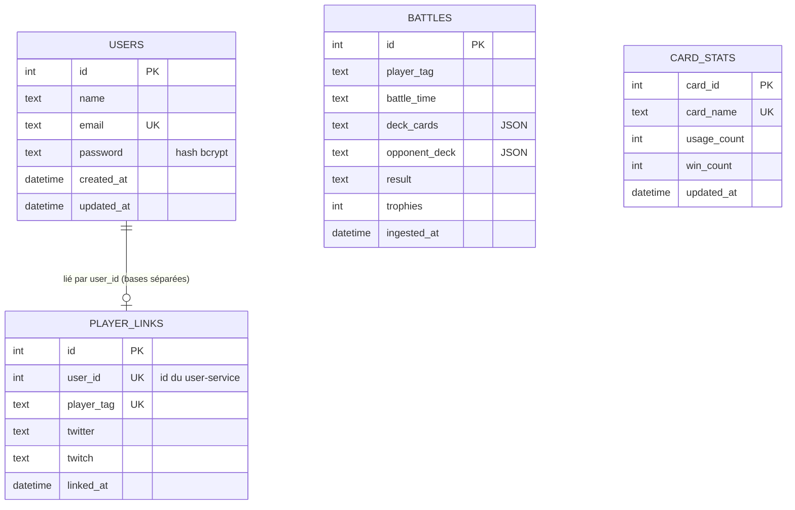

# Architecture de RoyaleStats

## Contexte produit

RoyaleStats est une plateforme web pour les joueurs de Clash Royale. Un visiteur consulte les statistiques d'un joueur ou d'un clan à partir de son **tag** (identifiant de jeu, par exemple `#2PP`). Un utilisateur inscrit peut **lier son compte RoyaleStats à son tag** pour retrouver directement son profil.

La fonctionnalité différenciante est le **Meta Tracker** : il analyse les combats des meilleurs joueurs pour identifier la méta (cartes dominantes, taux de victoire) et, à terme, conseiller le joueur sur son deck.

## Vue d'ensemble

## Règles d'architecture

1. **Le front ne parle qu'à l'API Gateway.** Toute nouvelle route d'un service est exposée par la Gateway et décrite dans sa spécification OpenAPI (`api-gateway/src/openapi.ts`).
2. **Seul `clash-data-service` appelle l'API officielle Clash Royale.** Les autres services passent par lui, ce qui centralise la clé API, le cache et la gestion des quotas.
3. **Chaque service possède sa base.** Aucun service ne lit la base d'un autre : il passe par son API.
4. **Le code commun va dans `shared`** (types, logger, client HTTP, configuration CORS). Pensez à `pnpm --filter shared build` après chaque modification.

## Services

| Service                | Port                        | Responsabilité                                                                   | Stockage                |
| ---------------------- | --------------------------- | -------------------------------------------------------------------------------- | ----------------------- |
| `front`                | 8080 (80 dans le conteneur) | Interface ; nginx sert le build Vite et relaie `/api/*` vers la Gateway          | —                       |
| `api-gateway`          | 3000                        | Proxy vers les services, Swagger sur `/docs`, gestion des erreurs de proxy (502) | —                       |
| `user-service`         | 3002                        | Inscription, connexion, profil ; mots de passe hachés (bcrypt), JWT              | `users`                 |
| `link-service`         | 3005                        | Liaison compte ↔ tag, liens Twitter/Twitch                                      | `player_links`          |
| `clash-data-service`   | 3004                        | Client de l'API Clash Royale, cache en mémoire avec expiration                   | mémoire                 |
| `meta-tracker-service` | 3006                        | Worker de collecte, agrégats par carte, analyse de deck                          | `battles`, `card_stats` |
| `item-service`         | 3003                        | Héritage du TP microservices (CRUD d'exemple)                                    | `items`                 |
| `public-api`           | 3001                        | Héritage du TP microservices (routes d'exemple)                                  | —                       |

## Routes exposées par la Gateway

La Gateway retire son préfixe avant de transmettre la requête. La référence à jour reste le Swagger : <http://localhost:3000/docs>.

| Préfixe Gateway             | Service cible            | Routes principales                                                                                                                                                           |
| --------------------------- | ------------------------ | ---------------------------------------------------------------------------------------------------------------------------------------------------------------------------- |
| `/api/users`                | user-service `/users`    | `POST /register`, `POST /login`, `GET\|PUT\|DELETE /me`, `GET /`                                                                                                             |
| `/api/link`                 | link-service `/link`     | `POST /`, `GET /tag/:tag`, `GET\|PATCH\|DELETE /:userId`                                                                                                                     |
| `/api/clash`                | clash-data-service `/`   | `GET /players/:tag`, `GET /players/:tag/battles`, `GET /cards`, `GET /clans/:tag`, `GET /leaderboards`, `GET /leaderboard/:id`, `GET /locations/global/pathoflegend/players` |
| `/api/meta`                 | meta-tracker-service `/` | `GET /snapshot`, `POST /analyze/deck`, `GET /recommend/:playerTag`, `POST /ingest/battles`                                                                                   |
| `/api/royaleapi`            | royaleapi.com            | Relais des classements publics                                                                                                                                               |
| `/api/items`, `/api/public` | item-service, public-api | Héritage du TP                                                                                                                                                               |

## Données

`users`, `player_links` et `battles`/`card_stats` vivent dans **trois fichiers SQLite distincts** (`data/<service>/database.sqlite`, montés en volume Docker). La relation `users` → `player_links` est logique : aucune clé étrangère ne la garantit.

Chaque service crée ses tables au démarrage (`CREATE TABLE IF NOT EXISTS`). Le link-service ajoute aussi les colonnes `twitter` et `twitch` si elles manquent : c'est la seule migration du projet à ce jour.

## Flux principaux

**Recherche d'un joueur** : `HomeView` → `clash.service.ts` → nginx → Gateway `/api/clash/players/:tag` → `clash-data-service` → cache (5 min) ou API Clash Royale.

**Liaison d'un compte** : `LinkPlayerDialog` → Gateway `/api/link` → `link-service`, qui vérifie l'existence du joueur auprès de `clash-data-service`, puis enregistre la liaison (un compte et un tag au plus une fois chacun).

**Collecte de la méta** : au démarrage puis toutes les heures, le worker du `meta-tracker-service` récupère les 1 000 premiers joueurs du classement Path of Legends, lit leurs derniers combats via `clash-data-service` et met à jour `battles` et `card_stats`.

### Durées du cache (`clash-data-service`)

| Donnée              | Durée  |
| ------------------- | ------ |
| Profil joueur       | 5 min  |
| Combats d'un joueur | 2 min  |
| Liste des cartes    | 24 h   |
| Clans, classements  | 10 min |

## Implémenté et prévu

| Sujet               | État actuel                                              | Prévu                                                                          |
| ------------------- | -------------------------------------------------------- | ------------------------------------------------------------------------------ |
| Accès aux données   | SQL brut avec better-sqlite3                             | Un essai Prisma (décembre 2025) est archivé dans le tag `archive/prisma-setup` |
| Cache               | En mémoire, perdu au redémarrage                         | Redis si plusieurs instances                                                   |
| Meta Tracker        | Top cartes et taux de victoire de l'échantillon collecté | Analyse du deck actuel du joueur et suggestions (Story S4.2)                   |
| Archétypes de decks | —                                                        | Détection des decks populaires                                                 |

## Limites connues

Ces points sont suivis dans Jira ; ne les reproduisez pas dans du nouveau code.

- Les routes privées du `link-service` ne vérifient pas le JWT (Story S3.2).
- `POST /api/meta/ingest/battles` est accessible publiquement via la Gateway (Story S4.2).
- `GET /api/users` liste les utilisateurs sans authentification (Story S1.2).
- Chaque service a son propre format d'erreur ; un contrat commun est prévu (Epic E5, Error Management).

## Schémas de conception initiaux

Schéma des communications réalisé en début de projet :

