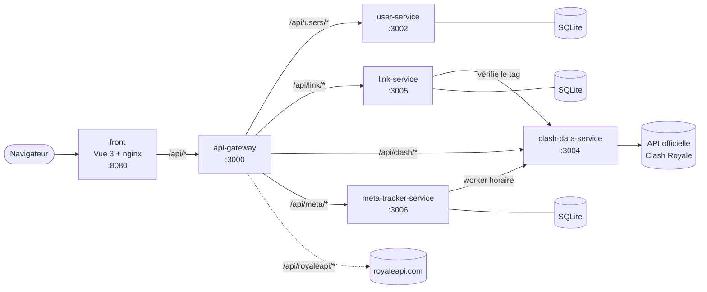
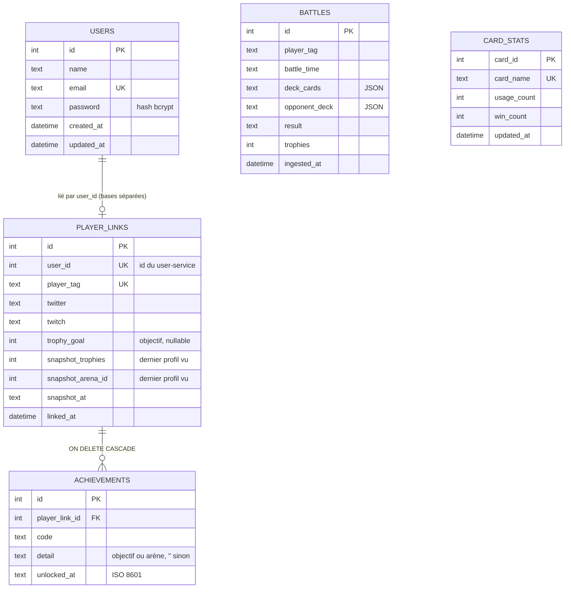
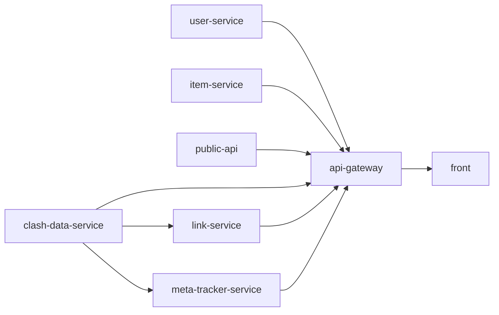

# Architecture de RoyaleStats

## Contexte produit

RoyaleStats est une plateforme web pour les joueurs de Clash Royale. Un visiteur consulte les statistiques d'un joueur ou d'un clan à partir de son **tag** (identifiant de jeu, par exemple `#2PP`). Un utilisateur inscrit peut **lier son compte RoyaleStats à son tag** pour retrouver directement son profil.

La fonctionnalité différenciante est le **Meta Tracker** : il analyse les combats des meilleurs joueurs pour identifier la méta (cartes dominantes, taux de victoire) et, à terme, conseiller le joueur sur son deck.

## Vue d'ensemble

## Règles d'architecture

1. **Le front ne parle qu'à l'API Gateway.** Toute nouvelle route d'un service est exposée par la Gateway et décrite dans sa spécification OpenAPI (`api-gateway/src/openapi.ts`).
2. **Seul `clash-data-service` appelle l'API officielle Clash Royale.** Les autres services passent par lui, ce qui centralise la clé API, le cache et la gestion des quotas.
3. **Chaque service possède sa base.** Aucun service ne lit la base d'un autre : il passe par son API.
4. **Le code commun va dans `shared`** (types, logger, client HTTP, configuration CORS). Pensez à `pnpm --filter shared build` après chaque modification.

## Services

| Service                | Port                        | Responsabilité                                                                   | Stockage                       |
| ---------------------- | --------------------------- | -------------------------------------------------------------------------------- | ------------------------------ |
| `front`                | 8080 (80 dans le conteneur) | Interface ; nginx sert le build Vite et relaie `/api/*` vers la Gateway          | —                              |
| `api-gateway`          | 3000                        | Proxy vers les services, Swagger sur `/docs`, gestion des erreurs de proxy (502) | —                              |
| `user-service`         | 3002                        | Inscription, connexion, profil ; mots de passe hachés (bcrypt), JWT              | `users`                        |
| `link-service`         | 3005                        | Liaison compte ↔ tag, liens Twitter/Twitch, objectif de trophées et succès      | `player_links`, `achievements` |
| `clash-data-service`   | 3004                        | Client de l'API Clash Royale, cache en mémoire avec expiration                   | mémoire                        |
| `meta-tracker-service` | 3006                        | Worker de collecte, agrégats par carte, analyse de deck                          | `battles`, `card_stats`        |
| `item-service`         | 3003                        | Héritage du TP microservices (CRUD d'exemple)                                    | `items`                        |
| `public-api`           | 3001                        | Héritage du TP microservices (routes d'exemple)                                  | —                              |

## Routes exposées par la Gateway

La Gateway retire son préfixe avant de transmettre la requête. La référence à jour reste le Swagger : <http://localhost:3000/docs>.

| Préfixe Gateway             | Service cible            | Routes principales                                                                                                                                                                                        |
| --------------------------- | ------------------------ | --------------------------------------------------------------------------------------------------------------------------------------------------------------------------------------------------------- |
| `/api/users`                | user-service `/users`    | `POST /register`, `POST /login`, `GET\|PUT\|DELETE /me`                                                                                                                                                   |
| `/api/link`                 | link-service `/link`     | `POST /`, `GET /tag/:tag`, `GET /tag/:tag/share`, `GET\|PATCH\|DELETE /:userId`, `GET /:userId/achievements`                                                                                              |
| `/api/clash`                | clash-data-service `/`   | `GET /players/:tag`, `GET /players/:tag/battles`, `GET /players/:tag/summary`, `GET /cards`, `GET /clans/:tag`, `GET /leaderboards`, `GET /leaderboard/:id`, `GET /locations/global/pathoflegend/players` |
| `/api/meta`                 | meta-tracker-service `/` | `GET /snapshot`, `POST /analyze/deck`, `GET /players/:tag/analysis`, `POST /players/:tag/ingest`                                                                                                          |
| `/api/royaleapi`            | royaleapi.com            | Relais des classements publics                                                                                                                                                                            |
| `/api/items`, `/api/public` | item-service, public-api | Héritage du TP                                                                                                                                                                                            |

## Données

`users`, `player_links` et `battles`/`card_stats` vivent dans **trois fichiers SQLite distincts** (`data/<service>/database.sqlite`, montés en volume Docker). La relation `users` → `player_links` est logique : aucune clé étrangère ne la garantit.

Chaque service crée ses tables au démarrage (`CREATE TABLE IF NOT EXISTS`). Le link-service a en plus des **migrations versionnées** (`link-service/src/database.ts`) : la version atteinte est stockée dans la base (`PRAGMA user_version`) et, au démarrage, chaque migration plus récente s'exécute une seule fois, dans sa propre transaction (une migration qui échoue laisse la base intacte). Une migration publiée n'est jamais modifiée : on en ajoute une nouvelle.

| Version | Contenu                                                                                                                                                                                               |
| ------- | ----------------------------------------------------------------------------------------------------------------------------------------------------------------------------------------------------- |
| 1       | `player_links`, et ajout de `twitter`/`twitch` aux bases créées avant ces colonnes                                                                                                                    |
| 2       | `trophy_goal` et instantané du profil dans `player_links`, table `achievements` ; mise à jour des données existantes : chaque liaison déjà faite débloque « Compte lié », daté de sa liaison (RST-53) |

## Flux principaux

**Recherche d'un joueur** : `HomeView` → `clash.service.ts` → nginx → Gateway `/api/clash/players/:tag` → `clash-data-service` → cache (5 min) ou API Clash Royale.

**Liaison d'un compte** : `LinkPlayerDialog` → Gateway `/api/link` → `link-service`, qui vérifie le JWT (le compte vient du token, jamais d'un `userId` envoyé par le client), vérifie l'existence du joueur auprès de `clash-data-service`, puis enregistre la liaison (un compte et un tag au plus une fois chacun). Un utilisateur ne peut lire, modifier ou supprimer que sa propre liaison (403 sinon) ; `GET /tag/:tag` est public et ne renvoie que le tag, les pseudos Twitter/Twitch et la date.

**Objectif et succès** : le joueur fixe un objectif de trophées (`PATCH /api/link/:userId`, `trophyGoal`). `GET /api/link/:userId/achievements` (JWT) et la page publique `GET /api/link/tag/:tag/share` lisent le profil et le battlelog via `clash-data-service`, enregistrent les succès débloqués puis renvoient objectif, progression et succès. Les règles sont dans `link-service/src/achievements.ts` : 5 et 10 victoires d'affilée et victoire 3 couronnes (datés du combat), objectif atteint (une fois par valeur d'objectif), nouvelle arène (arène différente avec plus de trophées que l'instantané précédent, pris à la liaison puis à chaque calcul). Un succès garde sa première date et reste acquis quand ses combats sortent du battlelog (l'API n'en garde qu'une trentaine). Si `clash-data-service` ne répond pas, les succès déjà enregistrés sont renvoyés avec `upToDate: false`. La page publique ne contient aucun identifiant de compte.

**Collecte de la méta** : au démarrage puis toutes les heures, le worker du `meta-tracker-service` récupère les 1 000 premiers joueurs du classement Path of Legends, lit leurs derniers combats via `clash-data-service` et met à jour `battles` et `card_stats`. Quand un joueur est consulté, le front demande aussi `POST /api/meta/players/:tag/ingest` : le service récupère lui-même ses combats, aucune route n'accepte de combats envoyés par un client. Chaque combat est lu du côté du joueur, validé, puis enregistré une seule fois (index unique `player_tag` + `battle_time`, un lot par transaction) ; un passage du worker encore en cours n'est pas doublé par le suivant.

**Analyse du deck** : `GET /api/meta/players/:tag/analysis` récupère le deck actuel du joueur via `clash-data-service` et le compare à l'échantillon. Une carte n'est notée qu'avec au moins 50 utilisations ; le taux du deck est pondéré par l'usage et comparé à celui de toute la méta. L'échantillon vient surtout des joueurs du top 1000, d'où une moyenne au-dessus de 50 % : c'est cette moyenne qui sert de référence. Une carte 2 points sous la méta reçoit jusqu'à 3 alternatives au même coût en élixir, avec au moins 2 points de mieux. Les règles sont dans `meta-tracker-service/src/services/deckAnalysis.ts`.

**Forme récente** : `GET /api/clash/players/:tag/summary` calcule, à partir du battlelog du joueur (même cache de 2 min que `/battles`, une trentaine de combats), victoires, défaites, nuls, winrate, série en cours et variation de trophées. Chaque combat est lu du côté du joueur ; un combat illisible sort de l'échantillon. Sous 5 combats exploitables, `insufficientData` vaut `true` et `winRate` est `null` : le front n'affiche jamais un 0 % trompeur. Un battlelog vide répond 200 avec un échantillon vide ; un tag inconnu (dont l'API renvoie pourtant un battlelog vide) répond 404, grâce au profil lu en parallèle ; une API Clash Royale indisponible reste une 503/504. Les règles sont dans `clash-data-service/src/recentForm.ts`.

### Durées du cache (`clash-data-service`)

| Donnée                             | Durée  |
| ---------------------------------- | ------ |
| Profil joueur                      | 5 min  |
| Combats d'un joueur, forme récente | 2 min  |
| Liste des cartes                   | 24 h   |
| Clans, classements                 | 10 min |

## Orchestration (Docker Compose)

Chaque service expose `/health` et possède un healthcheck. Un service ne démarre que lorsque ceux dont il dépend sont `healthy` (`depends_on` avec `condition: service_healthy`) :

| Réglage     | Valeur                                                               | Rôle                                             |
| ----------- | -------------------------------------------------------------------- | ------------------------------------------------ |
| Healthcheck | toutes les 10 s, 5 essais, 15 s de démarrage                         | Détecter un service qui ne répond plus           |
| `restart`   | `unless-stopped`                                                     | Redémarrer automatiquement un service qui plante |
| Limites     | 0,5 CPU et 256 Mo par service Node, 0,25 CPU et 128 Mo pour le front | Empêcher un service de monopoliser la machine    |
| Logs        | `json-file`, 3 fichiers de 10 Mo maximum                             | Éviter de remplir le disque                      |

Les réglages communs sont définis une seule fois dans `docker-compose.yml` (ancres YAML `x-node-service` et `x-healthcheck`).

## Implémenté et prévu

| Sujet               | État actuel                                                                                                                                                                    | Prévu                                                                          |
| ------------------- | ------------------------------------------------------------------------------------------------------------------------------------------------------------------------------ | ------------------------------------------------------------------------------ |
| Accès aux données   | SQL brut avec better-sqlite3                                                                                                                                                   | Un essai Prisma (décembre 2025) est archivé dans le tag `archive/prisma-setup` |
| Cache               | En mémoire, perdu au redémarrage                                                                                                                                               | Redis si plusieurs instances                                                   |
| Meta Tracker        | Top cartes et taux de victoire de l'échantillon collecté ; analyse du deck actuel d'un joueur (`GET /api/meta/players/:tag/analysis`) avec alternatives au même coût en élixir | Affichage de l'analyse dans le profil (RST-30)                                 |
| Archétypes de decks | —                                                                                                                                                                              | Détection des decks populaires                                                 |

## Limites connues

Ces points sont suivis dans Jira ; ne les reproduisez pas dans du nouveau code.

## Schémas de conception initiaux

Schéma des communications réalisé en début de projet :

